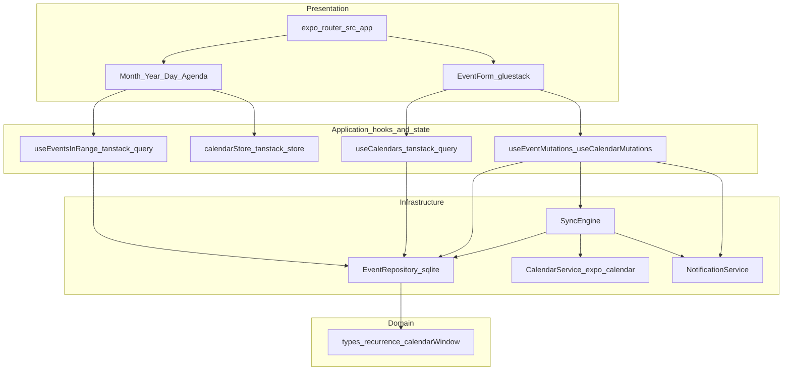

# Architecture

**Objectif.** Décrire les couches de l’application, les flux principaux et l’arborescence `src/` cible. Complète [SPECS.md](SPECS.md). Décisions : [adr/](adr/README.md).

## Couches



1. **Presentation** — écrans Expo Router + composants gluestack / vues calendrier custom
2. **State & Hooks** — TanStack Store (état UI client synchrone : `viewMode`, `cursorDate`, `locale`, `isLocalOnly`) + TanStack Query (`networkMode: 'always'`, cache SQLite local, invalidation déclarative et mutations) — pas de SQL direct dans les vues
3. **Domain** — types, fenêtres calendrier, expansion récurrence, validation URL
4. **Infrastructure** — SQLite, expo-calendar, expo-notifications

## Structure `src/` cible

```
src/
  app/                 # routes uniquement (kebab-case)
  components/
    AppBootstrap.tsx   # bootstrap SQLite/locale/permissions + sync foreground
    calendar/          # MonthView, WeekView, DayView, AgendaView, OccurrenceList, ViewTabBar
    event/             # EventForm, DateTimeField
  db/                  # client, schema, migrations
  domain/              # types.ts, calendarWindow.ts, recurrence.ts, url.ts, icsParser.ts
  lib/                 # queryClient.ts (TanStack Query offline-first + AppState focusManager)
  state/               # calendarStore.ts (TanStack Store UI state + sélecteurs)
  services/            # eventRepository, calendarDevice, syncEngine, notificationService, backgroundSync, icsFileReader, icsImportDraft
  hooks/
    queries/           # queryKeys, useCalendars, useEventsInRange, useEvent, useSearchEvents, useSettingsQueries
    mutations/         # useEventMutations, useCalendarMutations
    useThemePreference.tsx
  i18n/locales/{en,fr}/
  constants/           # tokens si besoin — alignés gluestack, pas de 2e design system
```

Ne pas co-localiser composants dans `app/` (skill `expo-router`).

## Flux CRUD événement (app)

1. `EventForm` (RHF) → `useCreateEvent` / `useUpdateEvent` / `useDeleteEvent`
2. `EventRepository.create/update/delete` → `SyncEngine.pushEvent` (device + notifications)
3. Invalidation TanStack Query (`queryKeys.events.all`) → rafraîchissement automatique du calendrier, du détail et de la recherche

## Flux pull device

1. `SyncEngine.pull(range)` liste événements device visibles
2. Upsert miroir SQLite + `sync_map`
3. LWW selon [SYNC.md](SYNC.md)
4. Reschedule notifs si dates changent
5. Invalidation TanStack Query (`calendars`, `events`, `backgroundSync`)

## Providers racine (`_layout.tsx`)

`GestureHandlerRootView` → `ThemePreferenceProvider` → `GluestackUIProvider` → `ThemeProvider` → `I18nextProvider` → `QueryClientProvider` → `AppBootstrap` + `NotificationBridge` + `RootStack`.

## Liens ADR

- Dev client : ADR-0001
- SQLite SoT : ADR-0002
- Sync device : ADR-0003
- gluestack : ADR-0004
